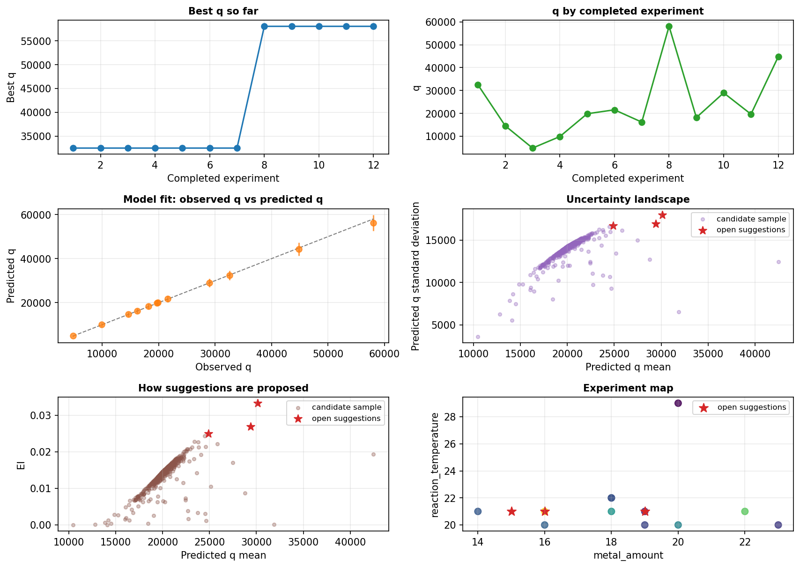

<div align="center">

# ActMOF Web App

**Bayesian optimization of MOF synthesis conditions, in the browser**

Propose a batch of syntheses, measure the PXRD patterns, enter the results, get the next batch.

[](https://actmof.streamlit.app/)

[](pyproject.toml)
[](pyproject.toml)
[](https://streamlit.io)
[](bo_engine.py)
[](https://github.com/deep-synthesis/ActMOF)

**[Open the app](https://actmof.streamlit.app/)** &nbsp;&middot;&nbsp; **[User guide](HELP.md)** &nbsp;&middot;&nbsp; **[Benchmark and data](https://github.com/deep-synthesis/ActMOF)**



<sub>Dashboard after twelve experiments (the example project in <code>experiments.csv</code>). Stars are the three conditions proposed next.</sub>

</div>

---

## What it does

The app runs the search loop of the ActMOF paper for your own synthesis. A Gaussian process learns how the
crystallinity index `q` (PXRD peak intensity / FWHM) depends on five synthesis variables, and an acquisition function
picks the conditions to try next. No installation is needed: open the link, and everything runs in the browser session.

```
 propose a batch  ->  run the syntheses  ->  measure PXRD  ->  enter results (or drop the .rasx file)
        ^                                                                    |
        +----------------------- model is refitted ---------------------------+
```

## Use it in four steps

| | Step | Where |
|---|---|---|
| 1 | Set the batch size, kernel and acquisition function (the defaults are Matérn-5/2 and expected improvement) | sidebar |
| 2 | Click **Initialize BO Optimization** to get the first batch | Batch Recommendations |
| 3 | Enter `intensity` and `fwhm` of every synthesis, or upload the `.rasx` file and let the app read them | Batch Recommendations |
| 4 | Click **Update Model & Save Batch Results**; the next batch appears. Repeat from step 3 | Batch Recommendations |

Download the project file before you leave: a browser session is not stored on the server.
[`HELP.md`](HELP.md) explains every step, first in plain language and then exactly.

## Features

| | |
|---|---|
| **Batch recommendations** | Gaussian process (Matérn-5/2 or 3/2) with expected improvement or probability of improvement; batches are kept diverse |
| **PXRD input** | Upload a Rigaku `.rasx` file: peak intensity, FWHM and `q` are read from the pattern and shown on it |
| **Dashboard** | Six diagnostic panels (best `q`, `q` of every experiment, model fit, uncertainty, acquisition, experiment map), downloadable as `.png` |
| **Project files** | Download the whole project (settings, experiments, candidate list, proposed batch) as one `.zip`, upload it later to continue |
| **Candidate lists** | Upload a `.csv` of allowed conditions to restrict what can be proposed |
| **Result entry** | `q` is calculated as soon as intensity and FWHM are entered; intensity `0` sets the no-product placeholder; empty cells are flagged; a saved batch can be reopened and corrected |
| **Experiment table** | Upload, edit and export all experiments as `.csv` |
| **Transfer prior** | Optional: the first batches are guided by the 95 measured MOF-321 conditions, calibrated to your own results as they arrive |
| **Planning wizard** | Estimates the number of batches for which the transfer prior is used |

## The five variables

Every condition is five integer codes. The app never proposes a value outside the ranges.

| Code | Range | Meaning in the ActMOF paper | One step |
|---|---|---|---|
| `metal_amount` | 5-75 | AlCl<sub>3</sub>&middot;6H<sub>2</sub>O stock solution | one volume increment |
| `modulator` | 5-15 | NaOH stock solution | one volume increment |
| `add_solvent` | 0-30 | additional DI water | one volume increment |
| `reaction_time` | 1-12 | microwave hold time | 5 min |
| `reaction_temperature` | 10-30 | microwave temperature | 5 &deg;C |

One volume increment was 0.1 mL in the MOF-321 dataset and 10 &micro;L in the six validation campaigns of the paper.
The target is `q` = peak intensity / FWHM of the diagnostic PXRD reflection; a synthesis without product has `q = 0`.

## Project files

*Download Project (.zip)* in the sidebar writes one archive:

| File | Content |
|---|---|
| `project_config.json` | settings of the sidebar and the planning wizard |
| `experiments.csv` | all saved experiments |
| `candidate_pool.csv` | your candidate list (only if one was uploaded) |
| `active_suggestions.csv` | the batch that is proposed but not yet measured |

These are the files of a project folder of the desktop app, so an unzipped project opens there and a zipped
desktop project folder loads here.

## Run it locally

```bash
git clone https://github.com/Mr-Thiol/ActMOF_Website.git
cd ActMOF_Website
uv sync --frozen
uv run streamlit run app.py
```

Then open `http://localhost:8501`. Without [`uv`](https://docs.astral.sh/uv/): `pip install streamlit numpy pandas matplotlib fairmat-readers-xrd`
and `streamlit run app.py`.

<details>
<summary><b>Deploying your own copy on Streamlit Community Cloud</b></summary>

1. Fork this repository (keep `app.py`, `pyproject.toml` and `uv.lock` at the root).
2. On [share.streamlit.io](https://share.streamlit.io), create an app from the fork with `app.py` as the entry point.
3. In the advanced settings, choose Python 3.10 or 3.11.

Community Cloud installs the environment from `uv.lock` and redeploys whenever the deployed branch receives a commit.

</details>

<details>
<summary><b>Desktop version</b></summary>

`student_bo_app_v109.py` is the same optimizer with a Tkinter window; it stores every project in a folder on disk.
Run it with `python student_bo_app_v109.py`, or build a Windows `.exe` with
`python one_click_build_mof_bo_student_app_v109.py` (needs PyInstaller).

</details>

## Files

| File | Content |
|---|---|
| `app.py` | the Streamlit app |
| `bo_engine.py` | Gaussian process, acquisition functions, batch selection, transfer prior, dashboard figure (NumPy only) |
| `batch_tools.py` | automatic values and checks for entered results, reopening the last batch |
| `project_io.py` | project files (`.zip`), candidate lists (`.csv`), figure export |
| `rasx_process.py` | reads peak intensity, FWHM and `q` from a Rigaku `.rasx` file |
| `experiments.csv` | example project: twelve experiments in four batches and a proposed fifth batch |
| `HELP.md` | user guide (also in the Help tab of the app) |
| `student_bo_app_v109.py`, `one_click_build_mof_bo_student_app_v109.py` | desktop version and its `.exe` builder |
| `pyproject.toml`, `uv.lock`, `.streamlit/config.toml` | dependencies and Streamlit settings |

## Related

- **[deep-synthesis/ActMOF](https://github.com/deep-synthesis/ActMOF)**: the landscape of 6,101,172 conditions, the benchmark of
  39 search strategies and the data of the six validation campaigns.
- The layout of the app follows [EDBO+](https://github.com/doyle-lab-ucla/edboplus).

## Citation

> Sheng, H.; Liang, S.; Coyle, R. A.; Pal, S. C.; Walther, P.; Feng, B.; Ding, X.; Lin, N.; Zheng, Z.
> ActMOF: Mapping Reticular Synthesis through Active Learning.
